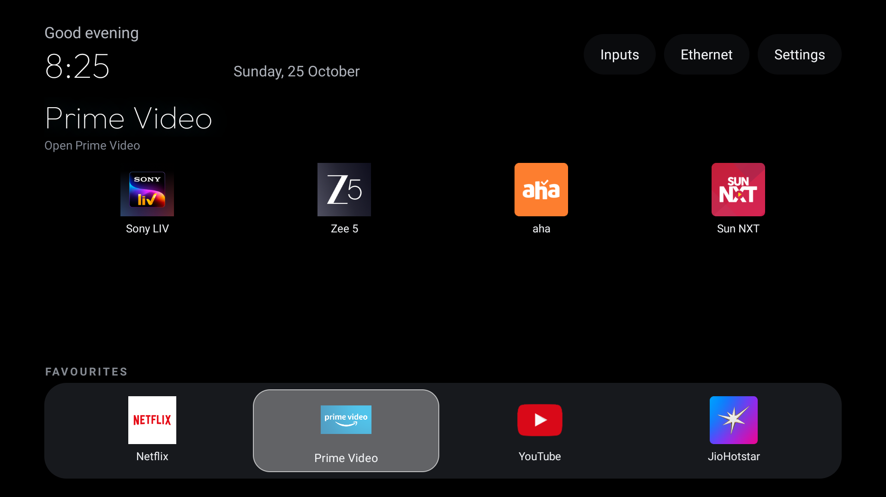
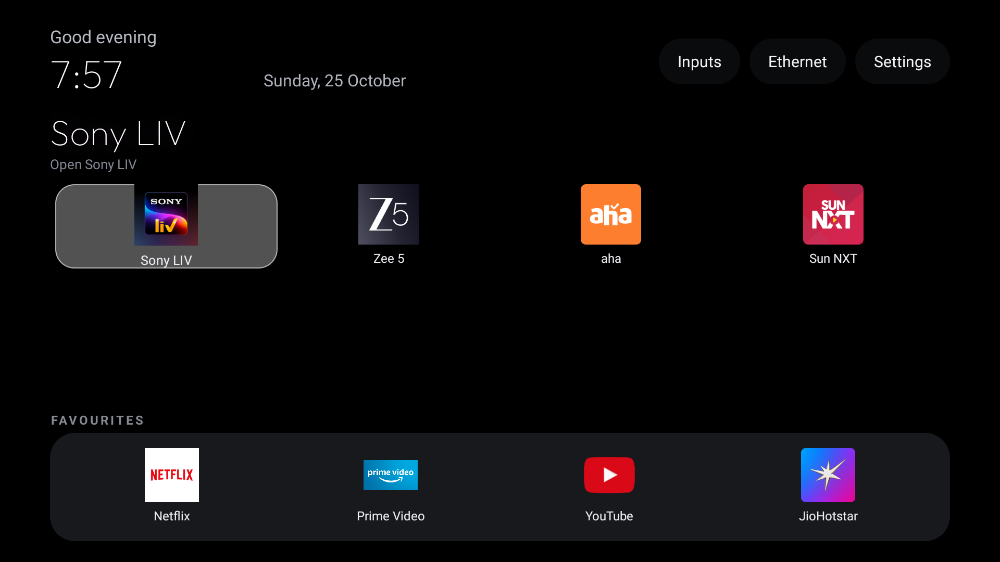

# Debloat Android TV

### A quieter home screen, built around the apps you actually watch.

<p align="center">
  
</p>

<p align="center"><sub>Real screen capture from the TV during the project · Sony BRAVIA KD-49X7500E</sub></p>

Home should take you straight to your shows. This project started by clearing away the stock home screen's
promotions and recommendation rows, then shaping a single, remote-friendly home around the eight streaming
apps the household chose.

We backed up the TV, reviewed its packages, disabled only the unwanted manufacturer feedback and content
services, and kept the streaming apps and TV features the family uses. Then we installed the native launcher
and checked its focus movement, Inputs menu and Home behavior with screenshots from the real screen. The result
is a dark, calm home that feels made for this TV instead of another feed to scroll through.

## The finished home

The dock keeps the four everyday picks close: **Netflix · Prime Video · YouTube · JioHotstar**. The rest of the
home grid holds **Sony LIV · ZEE5 · aha · Sun NXT**, so all eight services are available from the same Home
screen. The App Library can bring any installed app back onto Home.

<table>
  <tr>
    <td width="50%"></td>
    <td width="50%"></td>
  </tr>
  <tr>
    <td align="center"><sub>App grid and focused tile</sub></td>
    <td align="center"><sub>Inputs dropdown: AV, Live TV and HDMI</sub></td>
  </tr>
</table>

## What we built and verified

- **A native Android TV launcher** with a pitch-black canvas, rounded glass dock, focused app title and a single
  moving highlight that follows the D-pad.
- **A one-home app layout** with four dock slots and the remaining selected streaming apps in the grid.
- **A real Inputs menu** for AV, Live TV and the TV's HDMI ports, opened through the Android TV input system.
- **A useful top bar** with a time-aware greeting, clock, date, Inputs, Ethernet status and Settings.
- **Wallpaper controls** including a wallpaper-only view. On the configured TV, Red toggled that view and Blue
  opened TV Settings. The selected-app colour effect can be turned off without hiding the wallpaper.
- **At-a-glance RAM and storage percentages** in one compact status bubble.
- **A clock screensaver**, an App Library for managing Home shortcuts, and D-pad navigation that remembers
  focus.
- **Smoother focus motion** tuned for the TV, with less overshoot while keeping the glass styling.

The screenshots above are genuine captures from the setup session, not mockups. Home remained available after
a reboot, and the remote's Inputs menu showed the TV's actual AV, Live TV and HDMI sources.

## What is in this repository

This repository is intentionally focused on the launcher: Java source, Gradle build files and the screenshots
shown above. The per-TV setup profile, device backup, debloat scripts, wallpaper collection and separately
installed AirPlay receiver are not bundled here. AirPlay mirroring from an iPhone 13 was verified separately
on the TV; it is not a launcher feature.

The launcher source supports themes and remote-key actions. The screenshots document the customized setup used
for this project; the per-TV configuration itself is not included in this launcher-only repository.

## Build

The launcher targets Android TV devices running Android 8.0 or newer (minimum SDK 26). Build with JDK 17 and
Android SDK platform 34.

**Windows PowerShell**

```powershell
cd launcher
.\gradlew.bat assembleRelease
```

**macOS or Linux**

```bash
cd launcher
./gradlew assembleRelease
```

The release APK is written to `launcher/app/build/outputs/apk/release/app-release.apk`. Install it on a
compatible TV using ADB, then select it as the Home app in the TV's launcher settings.

---

Built from the open-source [CleanYourTV launcher](https://github.com/Gathin23/cleanyourtv), then configured
and refined on a real television for the apps, remote and inputs used in this home.
