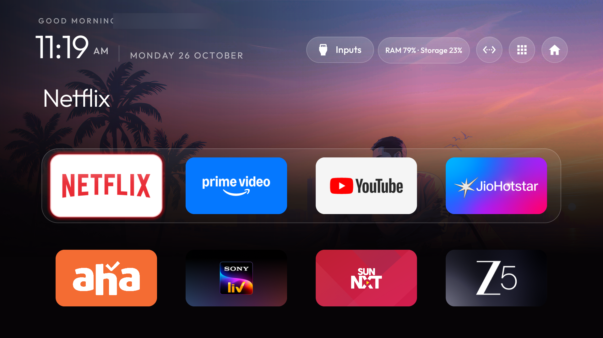
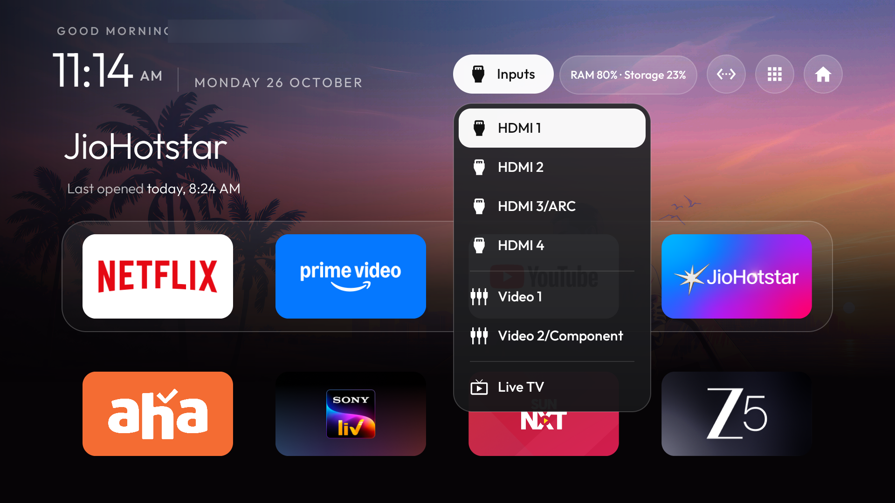
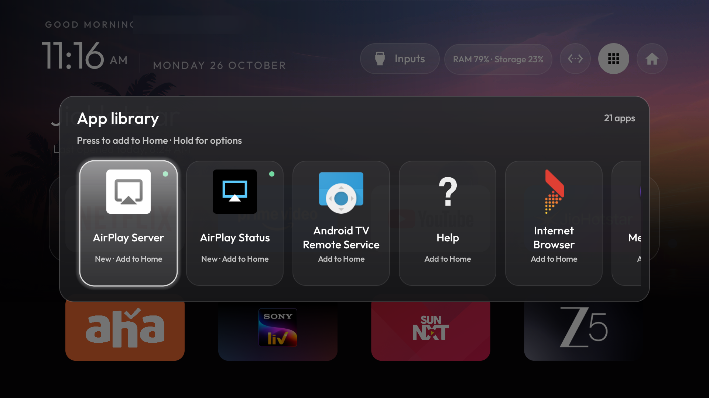
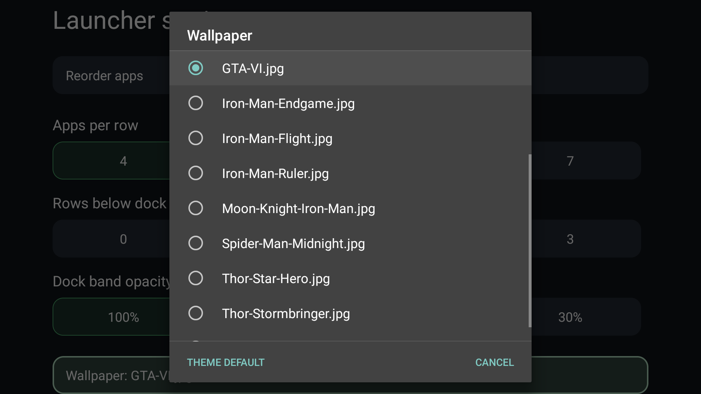
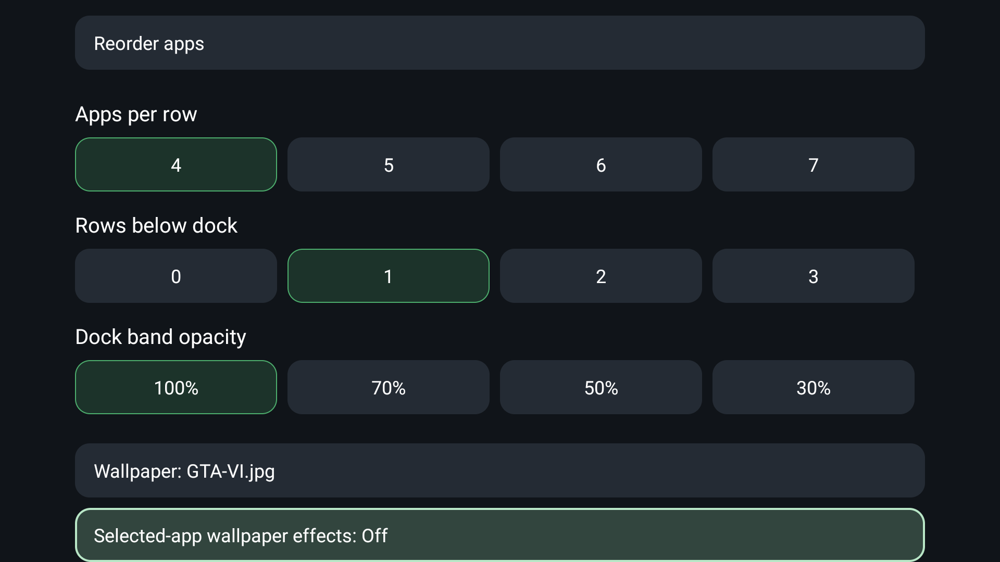

# Debloat Android TV — Glass Home

### A quieter Home screen, shaped around the way this household watches TV.

The stock home had turned into a wall of promotions and recommendation rows. This project started with a simple goal: make Home feel like *our* TV again—open, clear, and easy to drive with a remote.

We reviewed the Sony BRAVIA KD-49X7500E package list, backed up its settings, and disabled selected feedback, reporting, and manufacturer content/recommendation services without uninstalling packages. The household’s streaming apps, voice assistant, Chromecast, Miracast, and firmware updates stayed available. Then we made a native Android TV launcher the primary Home and refined it against the real screen, one change at a time.

<p align="center">
  
</p>

<p align="center"><sub>Current Home capture from the TV · personalized name blurred for privacy</sub></p>

## The home we built

The screen keeps the everyday apps in a four-slot glass dock: **Netflix, Prime Video, YouTube, and JioHotstar**. **Sony LIV, ZEE5, aha, and Sun NXT** sit in the grid immediately below, so all eight selected services are on one Home page.

The design takes its cue from Apple TV: a dark canvas, a softly translucent dock, one glass focus highlight that glides between tiles, and a focused title with a subtle colour glow. The selected wallpaper stays visible behind the interface. Motion was shortened after tuning on the TV, while the focus treatment and other visual effects stayed in place.

The top bar brings together a time-aware greeting, a thin clock and date, the TV’s Inputs, and a compact **RAM % · Storage %** status pill. The percentages are live readings and change with the TV’s workload.

## Details that make it feel like this TV

<table>
  <tr>
    <td width="50%"></td>
    <td width="50%"></td>
  </tr>
  <tr>
    <td align="center"><sub>Inputs opens the TV’s HDMI, video and Live TV sources.</sub></td>
    <td align="center"><sub>App Library: press an app to add it to Home; hold for more options.</sub></td>
  </tr>
  <tr>
    <td width="50%"></td>
    <td width="50%"></td>
  </tr>
  <tr>
    <td align="center"><sub>Choose from the wallpapers uploaded to the TV.</sub></td>
    <td align="center"><sub>Keep the wallpaper while independently turning selected-app colour effects off.</sub></td>
  </tr>
</table>

- **Add apps whenever you like.** Open the App Library and press an app to add or remove it from Home; hold for its options.
- **Make the wallpaper the screen.** On this TV, Red toggles the wallpaper-only view and brings the apps back on the next press.
- **Keep the wallpaper’s colour.** A launcher setting switches off the selected-app gradient without switching off the wallpaper.
- **Reach TV controls quickly.** Blue opens TV Settings on this remote. The Inputs menu uses the TV’s input framework rather than a mock list.
- **Keep a clock for idle moments.** The launcher’s clock screensaver remains available in the setup.
- **Mirror an iPhone.** AirPlay mirroring from an iPhone 13 was verified on the TV. The receiver apps were installed separately and are shown in the App Library; they are not part of this launcher repository.

The screenshots in this README were freshly pulled from the TV for this update. Personal greeting text is blurred in the public images.

## What this repository contains

This is the launcher-only project requested for the repository: Java launcher source, Gradle build files, the font licence, a build-and-install helper, and the fresh screenshots above. The TV backup and package lists, per-TV theme/profile, uploaded wallpaper files, and separately installed AirPlay receiver are not included.

The Red and Blue button mappings describe the profile used on this TV. Remote mappings and appearance can differ across devices; the repository does not claim those buttons are universal defaults.

## Build

The launcher supports Android TV devices running Android 8.0 or newer (**minSdk 26**). Build with JDK 17 and Android SDK platform 34.

**Windows PowerShell**

```powershell
cd launcher
.\gradlew.bat assembleRelease
```

**macOS or Linux**

```bash
cd launcher
./gradlew assembleRelease
```

The release APK is written to `launcher/app/build/outputs/apk/release/app-release.apk`. The launcher is built for sideloading and Home selection on a compatible Android TV.

---

Built on the open-source [CleanYourTV launcher](https://github.com/Gathin23/cleanyourtv), then configured and refined for one real TV, one remote, and the apps this household chose.
